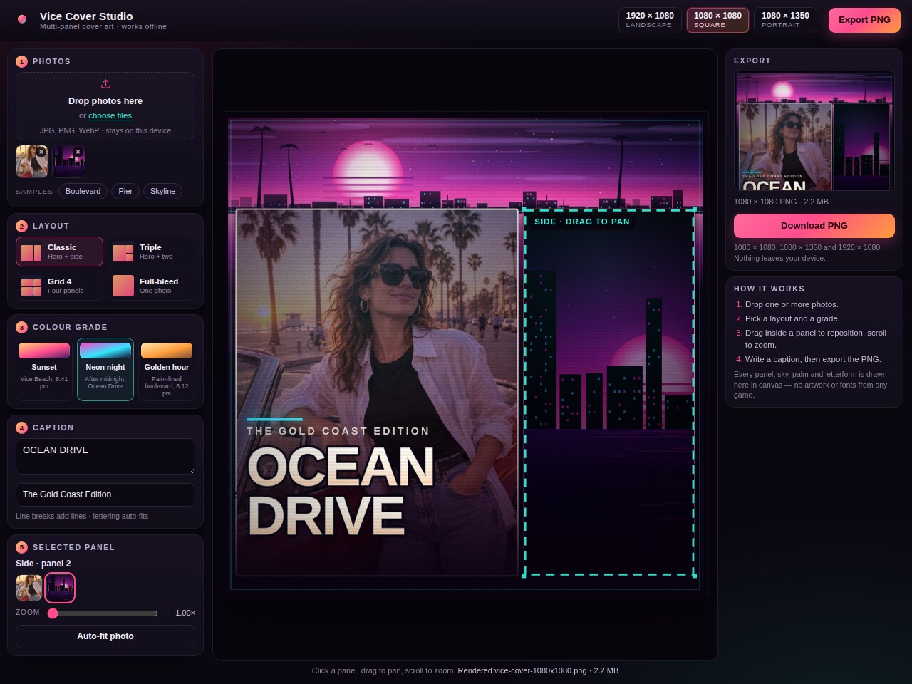
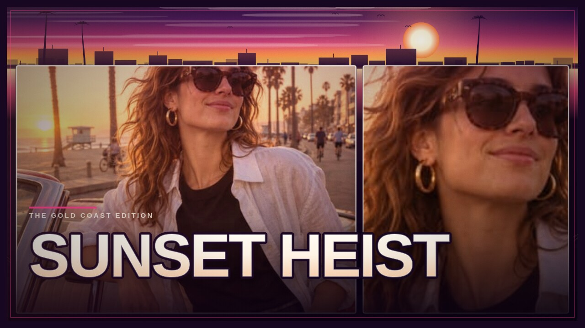
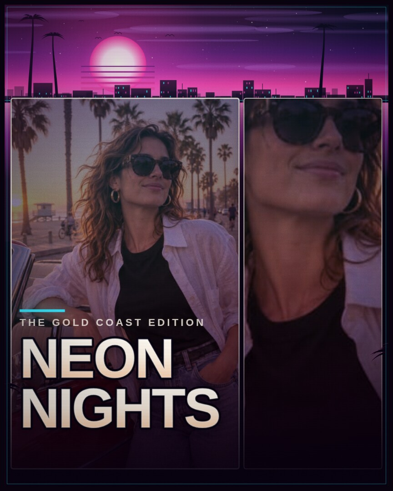
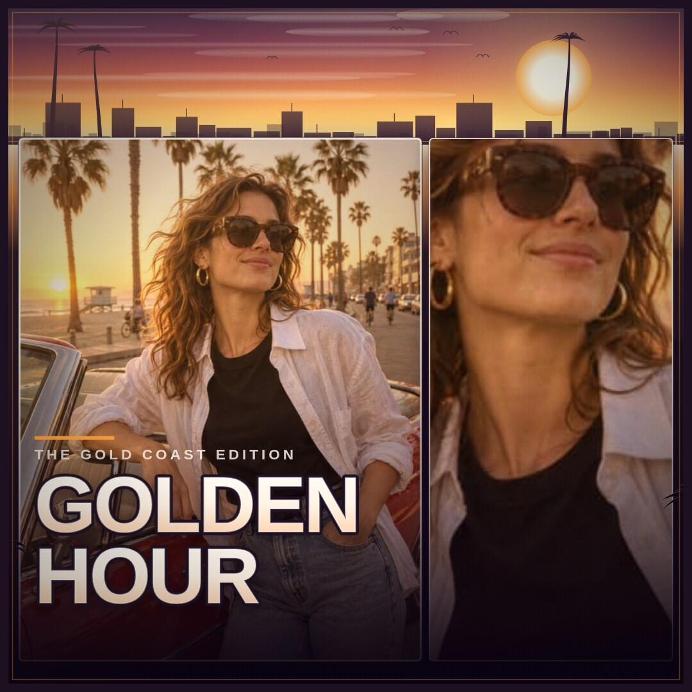

# Vice Cover Studio

A GTA-style cover art maker that runs entirely in the browser: drop in one or more photos, place
them in a multi-panel poster, pan and zoom each crop, write a bold caption, pick a Vice City colour
grade and export a share-ready PNG at 1080 × 1080, 1080 × 1350 or 1920 × 1080.



Everything is drawn by the app's own canvas code — the sunset sky, sun, clouds, skyline, palms,
film grain, chromatic edge, panel borders and the lettering. No artwork, logo, wordmark or font file
from any game is used or imitated.

## What it does

- **Photos** — drag and drop onto the page or the drop zone, or pick files. Files are decoded on the
  device with `createImageBitmap` and never uploaded; nothing in the app makes a network request.
  Three sample photos are built in (two bundled, one drawn procedurally).
- **Layouts** — Classic (hero + side), Triple (hero + two), Grid 4 (four panels) and Full-bleed hero,
  with a mini diagram of each in the rail. Panels are filled from the loaded photos; any photo can be
  placed in any panel from the "Selected panel" card.
- **Per-panel crop** — click a panel, drag to pan, scroll to zoom (1×–4×), or press Auto-fit. Each
  panel keeps its own crop.
- **Caption** — a bold uppercase title, auto-fitted and wrapped to the poster's caption box, with a
  dark outline, a warm gradient fill, a chromatic fringe and a drop shadow. A small tracked "edition"
  sub-line sits above it with an accent rule. Line breaks add lines.
- **Grades** — Sunset, Neon night and Golden hour. Each grade sets the sky palette, the sun, the haze,
  the grain, the scanlines and the duotone wash laid over every photo, so different photos still read
  as one poster.
- **Export** — renders the same drawing code at full resolution, encodes a PNG, downloads it, and
  shows the exported file, its pixel size and its byte size in the Export card.

| Landscape | Portrait | Square |
|---|---|---|
|  |  |  |
| 1920 × 1080, Sunset | 1080 × 1350, Neon night | 1080 × 1080, Golden hour |

## Run it

No build step, no dependencies, no network. Serve the `app/` directory with any static server:

```sh
node serve.ts            # http://localhost:8080  (Node 22, standard library only)
```

or

```sh
cd app && python3 -m http.server 8080
```

Then open <http://localhost:8080> in desktop Chrome and drop a photo in.

## Screenshot scenes

The app has a deterministic shot mode for its screenshots (`app/src/shots.js`):

```
?shot=cover&photo=boulevard&caption=Sunset%20Heist&grade=sunset&layout=classic&size=1920x1080
?shot=editor&photo=boulevard&photo2=skyline&caption=Ocean%20Drive&grade=neon&size=1080x1080&export=1
```

`shot=cover` renders a finished cover through the real PNG export and shows that PNG alone;
`shot=editor` fills the studio with photos, a layout and a grade. Other parameters: `photo`, `photo2`,
`photo3` (`boulevard`, `pier`, `skyline`), `caption`, `edition`, `grade` (`sunset`, `neon`, `golden`),
`layout` (`classic`, `triple`, `grid`, `hero`), `size` (`1080x1080`, `1080x1350`, `1920x1080`),
`crop0`…`crop3` (`zoom,ox,oy`), `zoom`, `panel` and `export=1`.

`node shots.mjs` re-captures `screenshots/` from `shots.json` with headless Chrome.

## Code map

| File | Job |
|---|---|
| `app/index.html` | the studio's markup |
| `app/style.css` | the studio's look and the `@font-face` for the bundled font |
| `app/src/main.js` | wiring: import, controls, live preview, pan/zoom, export |
| `app/src/photos.js` | reading the user's files, thumbnails, bundled and procedural samples |
| `app/src/panels.js` | layout presets, panel rectangles, crop maths, hit testing |
| `app/src/poster.js` | the compositor: sky → panels → foreground → caption → finish |
| `app/src/grade.js` | grade palettes, sky, sun, clouds, skyline, palms, grain, frame |
| `app/src/lettering.js` | caption fitting, wrapping and drawing; edition line |
| `app/src/export.js` | export sizes, full-resolution render, PNG encode, download |
| `app/src/shots.js` | deterministic screenshot scenes |
| `main.ts` | hands the entry in: copies `app/` and `screenshots/`, writes `dossier.json` |

## Licences

- **App code**: MIT, see [LICENSE](LICENSE).
- **Font**: Liberation Sans (`app/fonts/LiberationSans-Regular.ttf` and
  `LiberationSans-Bold.ttf`), digitized data copyright © 2010 Google Corporation with Reserved Font
  Arimo, Tinos and Cousine; copyright © 2012 Red Hat, Inc. with Reserved Font Name Liberation.
  Licensed under the **SIL Open Font License, Version 1.1**; the full licence text ships beside the
  fonts at [`app/fonts/OFL.txt`](app/fonts/OFL.txt). No font is fetched at run time.
- **Sample photos**: `app/samples/boulevard.jpg` and `app/samples/pier.jpg` were made with an image
  model for make.fun and are free to use. The "Skyline" sample is not a file: it is drawn by
  `skylinePhoto()` in `app/src/photos.js` at run time.

## make.fun

Entered in make.fun's *Make GTA 6 Cover Art* competition (`gta6-cover-art-01`).

[](https://make.fun/c/gta6-cover-art-01)
[](https://make.fun/c/gta6-cover-art-01)
[](https://make.fun/c/gta6-cover-art-01)
